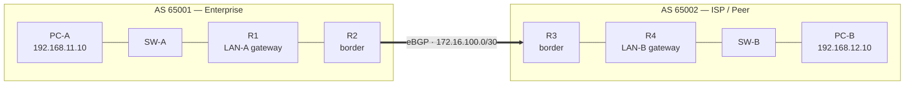

# LAB 9: BGP Fundamentals — eBGP Peering Between Two Autonomous Systems

The routing protocol that connects organisations to each other, built at
lab scale: two autonomous systems, OSPF inside each, **one eBGP session**
between their border routers, and a guided misconfiguration drill. This
is the lab that turns "BGP" from a keyword on other people's job
descriptions into something I have actually configured.

| | |
| --- | --- |
| **Author** | [Kazi Nafis Nawaz](https://github.com/kn2702-sys) · MCA (Networking) |
| **Platform** | Cisco Packet Tracer (NetAcad) |
| **Skills** | BGP · eBGP · OSPF · Routing · Troubleshooting |
| **Series** | [LAB 1](https://github.com/kn2702-sys/enterprise-vlan-lab) · [LAB 2](https://github.com/kn2702-sys/dhcp-dns-failure-lab) · [LAB 3](https://github.com/kn2702-sys/LAB-3-Multi-Router-OSPF-Network) · [LAB 4](https://github.com/kn2702-sys/LAB-4-ACL-NAT-Internet-Edge) · [LAB 5](https://github.com/kn2702-sys/LAB-5-Site-to-Site-VPN-Firewall) · [LAB 6](https://github.com/kn2702-sys/LAB-6-Wireshark-NOC-Troubleshooting) · [LAB 7](https://github.com/kn2702-sys/LAB-7-NOC-Incident-Simulation) · [Lab 8](https://github.com/kn2702-sys/LAB-8-AWS-VPC-Networking) · **LAB 9** |

> ## Status — read this first
>
> Configs are complete and internally consistent. The .pkt was generated
> programmatically (pktlib) from the configs in this repo and round-trip
> verified (re-opened and parsed: 8 devices, 7 links). It has NOT yet
> been opened in real Cisco Packet Tracer — the verification checklist
> in docs/VERIFICATION.md is the pending step, and the results will be
> recorded here once run. Nothing in this repo claims production BGP or
> ISP experience.

---

## Why BGP, and why a NOC engineer should care

OSPF (Lab 3) routes *inside* one organisation. BGP routes *between*
them: it is the protocol that stitches autonomous systems — companies,
ISPs, cloud providers — into the internet. Nobody hands an ISP their
internal topology; instead, each side advertises the prefixes it can
reach, and BGP carries those advertisements AS by AS.

That is also why BGP shows up in NOC and L1 network job descriptions
next to OSPF: when a customer's site "can't reach" a partner network,
the first questions are BGP questions. Is the session **Established**?
Is the prefix being **advertised**? What does the **AS path** look like?
This lab builds exactly those instincts, on a topology small enough to
hold in your head.

## Repository contents

```
Lab-9-BGP-Fundamentals.pkt      # the topology (open in Packet Tracer 8.2+)
configs/
  R1-Enterprise-Internal.txt    # AS 65001 - LAN-A gateway, OSPF
  R2-Enterprise-Border.txt      # AS 65001 - OSPF + eBGP border
  R3-Peer-Border.txt            # AS 65002 - eBGP + OSPF border
  R4-Peer-Internal.txt          # AS 65002 - LAN-B gateway, OSPF
  OPTIONAL-end-to-end-defaults.txt  # step-4 extension, see VERIFICATION
docs/
  BUILD.md          # build the topology by hand, step by step
  VERIFICATION.md   # the checklist: commands, expected output, the drill
  TROUBLESHOOTING.md
  INTERVIEW.md      # 10 BGP questions with model answers
scripts/
  build_topology.py # regenerates the .pkt from configs/ (pktlib)
```

## Topology



| Device | Interface | IP | Purpose |
|---|---|---|---|
| R1 | Gig0/0 → SW-A | 192.168.11.1/24 | LAN-A gateway |
| R1 | Gig0/1 → R2 | 10.1.12.1/30 | AS 65001 internal link |
| R1 | Loopback0 | 1.1.1.1/32 | Router ID |
| R2 | Gig0/0 → R1 | 10.1.12.2/30 | AS 65001 internal link |
| R2 | Gig0/1 → R3 | 172.16.100.1/30 | **eBGP transit link** |
| R2 | Loopback0 | 2.2.2.2/32 | Router ID |
| R3 | Gig0/0 → R2 | 172.16.100.2/30 | **eBGP transit link** |
| R3 | Gig0/1 → R4 | 10.2.34.1/30 | AS 65002 internal link |
| R3 | Loopback0 | 3.3.3.3/32 | Router ID |
| R4 | Gig0/0 → R3 | 10.2.34.2/30 | AS 65002 internal link |
| R4 | Gig0/1 → SW-B | 192.168.12.1/24 | LAN-B gateway |
| R4 | Loopback0 | 4.4.4.4/32 | Router ID |
| PC-A | NIC | 192.168.11.10/24, GW 192.168.11.1 | End-to-end test |
| PC-B | NIC | 192.168.12.10/24, GW 192.168.12.1 | End-to-end test |

Devices: 4× ISR 2911, 2× 2960-24TT, 2× PC-PT. OSPF area 0 runs inside
each AS only — the 172.16.100.0/30 transit link is in **neither** AS's
OSPF, by design: it belongs to BGP alone.

## Three ways to run this lab

1. **Open the .pkt** — `Lab-9-BGP-Fundamentals.pkt` in Packet Tracer
   8.2+, then work through `docs/VERIFICATION.md`.
2. **Build it by hand** — `docs/BUILD.md` gives the device list, cabling
   order, PC settings, and which config file to paste into which router.
3. **Regenerate the .pkt** — `pip install pktlib`, then
   `python3 scripts/build_topology.py`. The script reads `configs/` as
   the single source of truth and round-trip checks its own output.

## Verification (summary — full checklist in docs/VERIFICATION.md)

The base lab passes when all of these are true **in Packet Tracer**:

- [ ] R2's `show ip route` shows 192.168.11.0/24 as an OSPF route;
      R3's shows 192.168.12.0/24 the same way (OSPF healthy inside
      both ASes).
- [ ] `show ip bgp summary` on **both** borders shows the neighbour
      **Established**.
- [ ] `show ip bgp` on each border shows the *other* AS's LAN prefix
      with the peer as next hop; `show ip route bgp` shows it installed.
- [ ] End-to-end: with the two static defaults from
      `configs/OPTIONAL-end-to-end-defaults.txt` applied (the internal
      routers don't learn BGP routes — see VERIFICATION step 4 for why
      that is the teaching point), PC-A ↔ PC-B pings succeed.

## The drill: break the peering on purpose

After the base lab verifies, change one thing on R3 —
`neighbor 172.16.100.1 remote-as 65003` — and watch a production-style
failure from the inside: the session falls out of Established, the far
LAN's route vanishes, and the logs tell you where to look. Diagnose it,
fix it, re-verify. Full procedure in `docs/VERIFICATION.md` step 5;
the story it gives you is interview question 10 in `docs/INTERVIEW.md`.

## Troubleshooting

Seven symptom → cause → check rows in
[docs/TROUBLESHOOTING.md](docs/TROUBLESHOOTING.md) — neighbour stuck in
Idle, stuck in Active, Established-but-prefix-missing, ping fails with
healthy BGP, and more, each with the exact command that settles it.

## Interview prep

[docs/INTERVIEW.md](docs/INTERVIEW.md) — 10 questions with concise
model answers: what an AS is, eBGP vs iBGP, why BGP between
organisations and OSPF inside them, neighbour states, reading
`show ip bgp summary`, the `network` statement's routing-table rule,
next hop, the /30 transit, path attributes at awareness level, and the
drill as a troubleshooting story.

## Honest scope

Packet Tracer lab. One eBGP session between two ASes, OSPF inside
each, prefixes advertised with `network` statements. **No** iBGP, no
route reflectors, no communities or policy tuning, no production or
ISP experience claimed — where a doc mentions those, it labels them
study material, not lab experience. The `.pkt` generation method and
its unverified-in-Packet-Tracer status are stated at the top of this
README, not buried.

## Requirements

- Cisco Packet Tracer 8.2+ for the topology.
- Python 3 + `pktlib` only if you want to regenerate the `.pkt`.

---

## License

MIT © 2026 Kazi Nafis Nawaz — see [`LICENSE`](LICENSE).

## Contact

- GitHub: [kn2702-sys](https://github.com/kn2702-sys)
- LinkedIn: [kazi-nafis-nawaz-55b670393](https://www.linkedin.com/in/kazi-nafis-nawaz-55b670393)
- Portfolio: [nafnet.space-z.ai](https://nafnet.space-z.ai)
